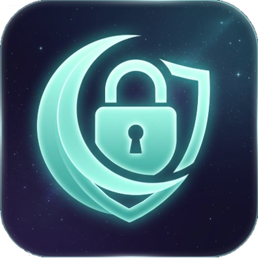

<p align="center">
  
</p>

# ShadowVPN

ShadowVPN é uma VPN de grupo inspirada no Radmin VPN, escrita em Rust. Cada computador recebe um IP virtual e pode acessar os outros membros do mesmo grupo. O tráfego entre os computadores é cifrado com WireGuard (BoringTun), e um servidor de relay encaminha os datagramas para que a VPN funcione atrás de NAT, sem abrir portas em cada cliente.

> Status: MVP funcional, mas **não auditado**. Use em laboratório, escritório ou comunidade de confiança. Leia a seção [Segurança](#segurança) antes de expor o servidor na internet.

## Recursos

- Rede privada por grupo, com senha compartilhada.
- IP virtual estável por identidade enquanto a sessão estiver ativa.
- Criptografia ponta a ponta WireGuard entre os peers.
- Relay UDP no servidor, sem necessidade de port forwarding nos clientes.
- Cliente CLI e GUI desktop (egui/eframe) com visual escuro inspirado em VPNs de grupo, painel de rede, lista de computadores e status em tempo real.
- Windows, Linux (x86_64 e aarch64) e macOS (Intel e Apple Silicon).
- Identidade WireGuard persistente e reutilizada entre conexões.
- Heartbeat, expiração de sessões e limpeza automática de peers inativos.
- Nomes dos computadores e latência do servidor exibidos na GUI.
- Releases automatizados com AppImage, instalador Windows, checksums e `wintun.dll` no pacote Windows.

## Como funciona

```text
┌──────────────┐        WireGuard cifrado         ┌──────────────┐
│  Cliente A   │◄───────────────┐         ┌───────►│  Cliente B   │
│ TUN 26.26... │                │         │        │ TUN 26.26... │
└──────┬───────┘                │         │        └──────┬───────┘
       │                        │         │               │
       │  HTTP 8080/tcp         ▼         ▼   HTTP 8080/tcp│
       │              ┌──────────────────────────┐         │
       └─────────────►│ Servidor de coordenação  │◄────────┘
                      │ grupos, sessões e IPs    │
                      └────────────┬─────────────┘
                                   │
                      relay UDP 8081 (pacotes WireGuard)
                                   │
                      ┌────────────▼─────────────┐
                      │      Relay UDP           │
                      │ só encaminha ciphertext  │
                      └──────────────────────────┘
```

1. O cliente gera uma chave WireGuard e faz `POST /register` com grupo, senha, chave pública e hostname.
2. O servidor valida a senha (hash Argon2), aloca um IP virtual e devolve a lista de peers e o endereço do relay.
3. O cliente cria a interface TUN e envia um `HELLO` UDP ao relay para registrar seu endereço público.
4. Cada peer mantém uma sessão WireGuard com os demais. O relay encaminha os datagramas pelo `session_id` de destino.
5. A cada 20 segundos o cliente reenvia o registro (idempotente) para renovar a sessão e atualizar a lista de peers.

O túnel cobre apenas a rede virtual `26.26.26.0/24`. Ele **não** roteia todo o tráfego da internet por padrão.

## Requisitos

- Servidor: Rust estável recente, Linux/macOS/Windows e portas TCP 8080 e UDP 8081 liberadas.
- Cliente: Rust estável recente e privilégios para criar a interface TUN.
- Windows: executar como Administrador e manter `wintun.dll` ao lado do executável.
- Linux: `/dev/net/tun` disponível e `root`, `CAP_NET_ADMIN` ou `sudo`.
- macOS: `sudo`, pois a interface `utun` e as rotas exigem privilégios.

## Início rápido

### 1. Servidor

```bash
cargo run --release -p shadowvpn-server
```

Por padrão, o servidor escuta em `0.0.0.0:8080` (HTTP) e `0.0.0.0:8081` (UDP relay). Para conferir:

```bash
curl http://127.0.0.1:8080/health
```

Se o servidor estiver atrás de proxy reverso ou NAT, informe o endereço público do relay:

```bash
SHADOWVPN_RELAY_ADVERTISE=vpn.exemplo.com:8081 cargo run --release -p shadowvpn-server
```

### 2. Cliente CLI

Em outro computador, com a mesma versão:

```bash
SHADOWVPN_SERVER=http://vpn.exemplo.com:8080 \
SHADOWVPN_GROUP=minha-rede \
SHADOWVPN_PASSWORD='uma-senha-forte' \
cargo run --release -p shadowvpn-client
```

O cliente imprime o IP virtual e o relay nos logs. Use `SHADOWVPN_LOG=debug` para mais detalhes.

Para parar, pressione `Ctrl+C`. O cliente remove o peer do grupo e encerra a interface.

### 3. GUI

```bash
cargo run --release -p shadowvpn-gui
```

Preencha servidor, grupo e senha e clique em **Conectar**. A GUI cria a interface TUN, mostra o IP virtual, o relay, sua chave pública e os peers conectados.

A GUI não eleva privilégios automaticamente. No Windows, abra como Administrador; no Linux/macOS, inicie pelo terminal com as permissões necessárias.

## Configuração

### Cliente

Flags da CLI (as variáveis de ambiente equivalentes estão entre parênteses):

| Flag | Variável | Padrão |
|---|---|---|
| `--server` | `SHADOWVPN_SERVER` | `http://127.0.0.1:8080` |
| `--group` | `SHADOWVPN_GROUP` | `minha-rede` |
| `--password` | `SHADOWVPN_PASSWORD` | obrigatória |
| `--identity` | `SHADOWVPN_IDENTITY` | caminho padrão do sistema |
| — | `SHADOWVPN_HOSTNAME` | hostname do sistema; exibido aos peers |

Prefira `SHADOWVPN_PASSWORD` em vez de `--password`: argumentos de linha de comando podem aparecer no histórico e na lista de processos.

O nome do grupo deve ter até 64 caracteres alfanuméricos, `-` ou `_`. A senha deve ter entre 8 e 128 caracteres.

A identidade é criada automaticamente e nunca deve ser copiada entre computadores:

- Linux: `$XDG_CONFIG_HOME/shadowvpn/identity.key` ou `~/.config/shadowvpn/identity.key`
- macOS: `~/Library/Application Support/shadowvpn/identity.key`
- Windows: `%APPDATA%\ShadowVPN\identity.key`

O arquivo tem permissão restrita no Unix. Se duas pessoas usarem a mesma identidade ao mesmo tempo, o servidor as tratará como o mesmo peer.

### Servidor

| Variável | Padrão | Descrição |
|---|---|---|
| `SHADOWVPN_LISTEN` | `0.0.0.0:8080` | Endereço HTTP da API |
| `SHADOWVPN_RELAY_LISTEN` | `0.0.0.0:8081` | Endereço UDP do relay |
| `SHADOWVPN_RELAY_ADVERTISE` | derivado do `Host` | Endereço público do relay devolvido aos clientes |
| `SHADOWVPN_PEER_TTL` | `75` | Segundos sem heartbeat até remover o peer (mínimo 30) |
| `SHADOWVPN_LOG` ou `RUST_LOG` | `info` | Filtro de logs, por exemplo `debug` |

Se `SHADOWVPN_RELAY_ADVERTISE` não for definido, o servidor usa o host do cabeçalho HTTP `Host` e a porta UDP efetiva. Em produção atrás de proxy reverso, defina explicitamente o endereço público:

```bash
SHADOWVPN_RELAY_ADVERTISE=vpn.exemplo.com:8081
```

Para IPv6, use colchetes: `SHADOWVPN_RELAY_ADVERTISE=[2001:db8::10]:8081`.

### API HTTP

| Método | Rota | Função |
|---|---|---|
| `GET` | `/health` | Saúde do servidor |
| `POST` | `/register` | Entrar no grupo e obter IP, sessão e peers |
| `POST` | `/peers` | Heartbeat alternativo e lista atualizada de peers |
| `POST` | `/unregister` | Sair do grupo |

O estado do servidor é mantido em memória. Reiniciar o processo apaga grupos e sessões; os clientes se registram novamente no próximo heartbeat. Se o IP virtual mudar, reconecte o cliente.

## Portas, firewall e HTTPS

- **8080/tcp**: API de coordenação. Pode ficar atrás de um proxy reverso com HTTPS.
- **8081/udp**: relay. Precisa estar acessível diretamente pelos clientes; não é proxy HTTP.
- Libere as duas portas no firewall do servidor e no provedor de nuvem.

Exemplo de proxy TLS com Caddy:

```caddyfile
vpn.exemplo.com {
    reverse_proxy 127.0.0.1:8080
}
```

Nesse caso, mantenha `SHADOWVPN_LISTEN=127.0.0.1:8080` e configure `SHADOWVPN_RELAY_ADVERTISE=vpn.exemplo.com:8081`. Sem HTTPS, a senha do grupo e as chaves públicas trafegam em texto claro.

## Permissões por sistema

### Linux

Opção recomendada, sem executar como root:

```bash
sudo setcap cap_net_admin+ep ./target/release/shadowvpn-client
sudo setcap cap_net_admin+ep ./target/release/shadowvpn-gui
```

Depois execute normalmente. Se preferir `sudo`:

```bash
sudo env \
  SHADOWVPN_SERVER=http://vpn.exemplo.com:8080 \
  SHADOWVPN_GROUP=minha-rede \
  SHADOWVPN_PASSWORD='uma-senha-forte' \
  ./target/release/shadowvpn-client
```

Use um `SHADOWVPN_IDENTITY` explícito se quiser que a chave criada pelo processo root pertença ao seu usuário.

O AppImage não carrega capabilities. Para usar a GUI empacotada, execute com `sudo`:

```bash
chmod +x ShadowVPN-v0.2.2-linux-x86_64.AppImage
sudo -E ./ShadowVPN-v0.2.2-linux-x86_64.AppImage
```

Alternativamente, extraia o AppImage com `--appimage-extract` e aplique `CAP_NET_ADMIN` ao binário interno.

### Windows

1. Prefira o instalador `ShadowVPN-vX.Y.Z-windows-x86_64-setup.exe`; ele inclui o `wintun.dll` e registra o executável para solicitar elevação.
2. Se usar o ZIP portátil, extraia, mantenha `wintun.dll` e `wintun-LICENSE.txt` na mesma pasta e execute `shadowvpn-gui.exe` como administrador.
3. Permita a rede no firewall do Windows quando solicitado.

Sem `wintun.dll`, a criação do TUN falha. O binário é x86_64.

### macOS

```bash
sudo ./shadowvpn-client
```

Se o arquivo foi baixado pelo navegador e o Gatekeeper bloquear:

```bash
xattr -dr com.apple.quarantine ShadowVPN-v0.2.2-macos-aarch64
```

Os binários não são assinados nem notarizados.

## Releases e build

Cada tag `v*` dispara `.github/workflows/release.yml` e publica:

| Sistema | Pacotes |
|---|---|
| Linux x86_64 | `ShadowVPN-vX.Y.Z-linux-x86_64.tar.gz` e `.AppImage` |
| Linux aarch64 | `ShadowVPN-vX.Y.Z-linux-aarch64.tar.gz` e `.AppImage` |
| Windows x86_64 | `ShadowVPN-vX.Y.Z-windows-x86_64.zip` e `-setup.exe` |
| macOS Intel | `ShadowVPN-vX.Y.Z-macos-x86_64.tar.gz` |
| macOS Apple Silicon | `ShadowVPN-vX.Y.Z-macos-aarch64.tar.gz` |

Os arquivos compactados incluem `shadowvpn-client`, `shadowvpn-server` e `shadowvpn-gui`; os AppImages incluem os três binários, o arquivo `.desktop` e o ícone para integração com o desktop. O pacote Windows portátil e o instalador incluem `wintun.dll` e a licença da Wintun. O release também publica `SHA256SUMS.txt` com os checksums de todos os artefatos.

Os binários Linux x86_64 são compilados no Ubuntu 22.04 (glibc 2.35) e os de aarch64 no Ubuntu 24.04 (glibc 2.39). A GUI Linux também precisa de bibliotecas de sistema para Wayland/X11 e OpenGL.

O instalador Windows foi compilado com Inno Setup e registra `shadowvpn-gui.exe` com a camada de compatibilidade `RUNASADMIN`, para que o UAC seja solicitado ao abrir a GUI. O ZIP continua disponível para uso portátil.

Para criar uma release:

```bash
git tag v0.2.2
git push origin v0.2.2
```

Também é possível executar o workflow manualmente em **Actions → Release multiplataforma → Run workflow**, informando uma tag que já exista no remoto.

Build local:

```bash
cargo fmt --all -- --check
cargo clippy --workspace --all-targets -- -D warnings
cargo test --workspace
cargo build --release --workspace
```

Binários gerados em `target/release/`: `shadowvpn-server`, `shadowvpn-client` e `shadowvpn-gui`.

## Segurança

- Os pacotes entre peers são cifrados e autenticados pelo WireGuard. O relay encaminha somente ciphertext, mas vê metadados como IPs públicos, sessões e volume de tráfego.
- A API de coordenação usa HTTP simples. Em qualquer rede não confiável, coloque-a atrás de HTTPS. A senha do grupo é enviada a cada requisição.
- O servidor armazena apenas o hash Argon2 da senha do grupo. A senha em texto claro existe somente durante a requisição.
- Os `session_id` são compartilhados com os peers do grupo para permitir o roteamento. Um membro mal-intencionado do grupo pode tentar interferir no relay; o WireGuard ainda impede a leitura ou falsificação dos pacotes, mas indisponibilidade e metadados não são protegidos.
- Qualquer pessoa que alcance a API pode criar um grupo novo e definir a senha dele. Use nomes de grupo difíceis de adivinhar ou pré-registre os grupos antes de divulgar o servidor.
- Não há rate limiting nem cotas por IP. Para um servidor público, coloque a API atrás de um proxy com limites de requisição e monitore o consumo de memória/CPU.
- Não há auditoria de segurança independente, testes de penetração ou garantia de anonimato.

## Limitações

- **Somente relay**: todo o tráfego passa pelo servidor; não há conexão direta P2P/STUN/TURN. A largura de banda do servidor limita a VPN.
- **IPv4 apenas**: rede virtual `/24`, máximo de 253 peers por grupo.
- **Sem multicast**: broadcast IPv4 é replicado para os peers, mas multicast não é suportado.
- **Sem DNS próprio**: acesse os peers pelo IP virtual; os nomes são apenas exibidos na GUI.
- **Estado em memória**: sem banco de dados; reiniciar o servidor perde grupos e sessões.
- **Sem NAT traversal para o servidor**: o relay UDP precisa ser alcançável na porta publicada.
- **Instalação limitada**: há instalador para Windows e AppImage para Linux; macOS continua apenas com binários portáveis. Não há serviço nem inicialização automática.
- **Sem assinatura de código**: Windows SmartScreen, o instalador e o macOS Gatekeeper podem avisar.
- **Sem túnel de internet completa**: apenas a sub-rede virtual é roteada.

## Solução de problemas

**A GUI mostra erro ao conectar e o túnel não sobe**
- Verifique se está executando como Administrador/root ou se concedeu `CAP_NET_ADMIN`.
- No Windows, confirme que `wintun.dll` está ao lado do `.exe`.

**Os peers aparecem, mas o ping não funciona**
- Confirme que os dois estão no mesmo grupo e com a mesma senha.
- Verifique se a porta UDP do relay está liberada no servidor e no provedor de nuvem.
- O firewall local pode bloquear ICMP. No Windows, permita ICMPv4 ou teste com uma conexão TCP.
- O MTU da interface é 1380 para acomodar WireGuard + relay.

**O relay devolvido aponta para 127.0.0.1 ou para o endereço errado**
- Defina `SHADOWVPN_RELAY_ADVERTISE` com o host/porta públicos.
- Se estiver atrás de proxy reverso, o cabeçalho `Host` pode não ser o endereço do relay.

**A conexão cai após reiniciar o servidor**
- O estado é em memória. Aguarde o próximo heartbeat ou reconecte o cliente. Se o IP virtual mudou, a GUI pede reconexão.

**Linux: erro de permissão em `/dev/net/tun`**
- Confirme que o dispositivo existe: `ls -l /dev/net/tun`.
- Use `sudo` ou `setcap cap_net_admin+ep` no binário.

## Estrutura

```text
shadowvpn-core/    DTOs, protocolo do relay, constantes e validações
shadowvpn-server/  API HTTP, grupos, sessões e relay UDP
shadowvpn-client/  API, identidade, TUN, WireGuard e motor do cliente
shadowvpn-gui/     Interface desktop egui/eframe
assets/            Ícone e identidade visual do ShadowVPN
.github/           CI e release multiplataforma
```

ShadowVPN não é afiliado ao Radmin VPN. WireGuard e BoringTun pertencem aos seus respectivos autores. A DLL da Wintun é distribuída sob a licença incluída no pacote Windows.
